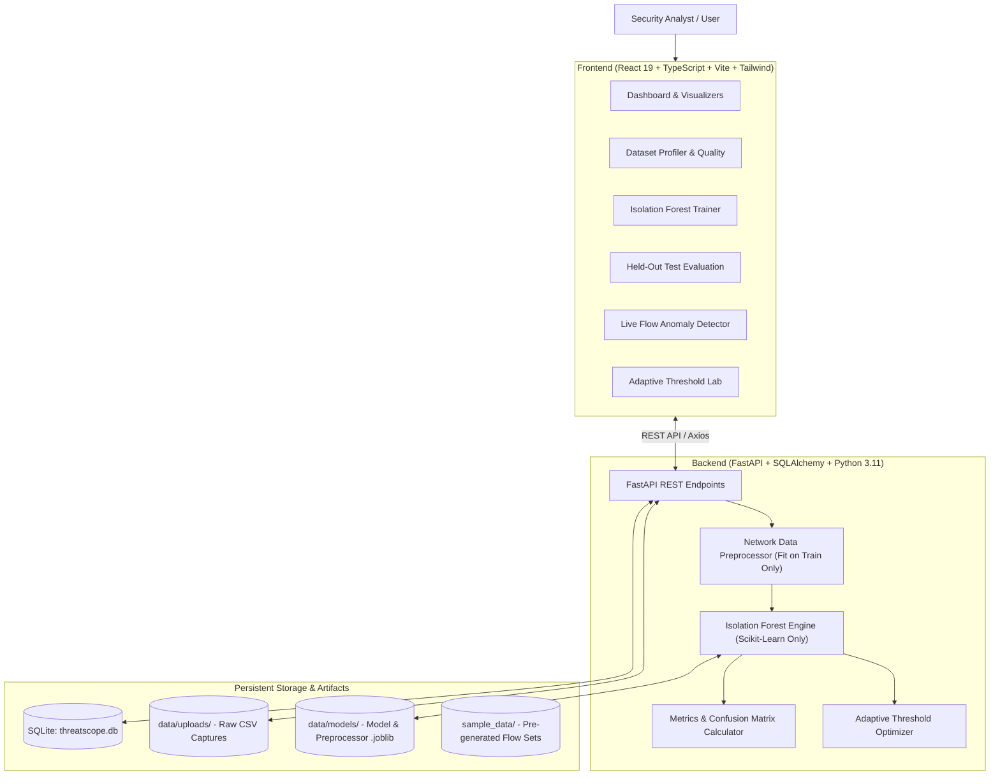

# ThreatScope: Machine Learning-Based Behavioral Anomaly Detection for Cybersecurity

[](https://www.python.org/)
[](https://fastapi.tiangolo.com/)
[](https://react.dev/)
[](https://www.typescriptlang.org/)
[](https://vitejs.dev/)
[](https://tailwindcss.com/)
[](https://scikit-learn.org/)

ThreatScope is a complete, functional, end-to-end cybersecurity application designed to detect anomalous network behavior using **Isolation Forest** trained from scratch on cybersecurity network flow traffic datasets.

---

## 1. Project Overview

Modern intrusion detection systems (IDS) require robust behavioral anomaly detection capable of isolating zero-day exploits and abnormal traffic patterns without relying exclusively on brittle static signatures.

ThreatScope provides:
* **Upload and Quality Management:** Ingest and profile CSV datasets (CIC-IDS2017, UNSW-NB15, or custom flow captures) with automated checks for duplicates, infinite values, missing entries, and data types.
* **From-Scratch Isolation Forest Training:** Train scikit-learn Isolation Forest ensembles on user-selected network flow metrics with configurable estimators, contamination, and random seed.
* **Data Leakage Prevention:** Feature transformations (medians, scaling, constant feature pruning) are fitted strictly on training data and frozen before evaluation or detection.
* **Strictly Verified Evaluation Metrics:** Calculate live, un-fabricated test accuracy, precision, recall, F1-score, false-positive rate, and confusion matrix using held-out test data.
* **Adaptive Threshold Experimentation:** A controlled research lab comparing fixed threshold ($0.0$) against validation-optimized decision thresholds.
* **Continuous Anomaly Scoring & Live Detection:** Score network flows, inspect anomaly score histograms, filter records, and export findings as CSV.

---

## 2. System Architecture



---

## 3. Technology Stack

* **Backend:**
  * **Python 3.11**
  * **FastAPI:** High-performance async REST API framework
  * **Scikit-Learn:** `sklearn.ensemble.IsolationForest` and evaluation metrics
  * **Pandas & NumPy:** Network flow preprocessing and numerical operations
  * **Joblib:** Versioned model artifact persistence
  * **SQLAlchemy & SQLite:** Database for training history, datasets, evaluations, and batches
  * **Uvicorn:** ASGI application server
  * **Pytest:** Comprehensive unit & integration testing
* **Frontend:**
  * **React 19 & TypeScript**
  * **Vite 6:** Ultra-fast bundler and development server
  * **Tailwind CSS:** Modern responsive cybersecurity SOC interface
  * **Recharts:** Interactive confusion matrix, metrics bars, and anomaly score distribution histograms
  * **Axios:** Type-safe HTTP communication
  * **Lucide React:** Security and telemetry icons

---

## 4. Supported Dataset Formats & Download Instructions

ThreatScope natively accepts network flow traffic CSV files formatted similarly to top academic and industry cybersecurity datasets:

### Compatible Datasets:
1. **CIC-IDS2017 (Canadian Institute for Cybersecurity):**
   * Official Source: [UNB CIC-IDS2017 Dataset](https://www.unb.ca/cic/datasets/ids-2017.html)
   * Key features: `Flow Duration`, `Total Fwd Packets`, `Total Backward Packets`, `Flow Bytes/s`, `Flow Packets/s`, `Packet Length Mean`, `SYN Flag Count`, `Label`.
2. **UNSW-NB15 (Cyber Range Lab of the Australian Centre for Cyber Security):**
   * Official Source: [UNSW-NB15 Dataset](https://research.unsw.edu.au/projects/unsw-nb15-dataset)
   * Key features: `dur`, `spkts`, `dpkts`, `sbytes`, `dbytes`, `rate`, `sttl`, `dttl`, `attack_cat`, `label`.

### Included Ready-to-Use Datasets:
The application comes pre-packaged with 4 realistic flow datasets generated under `sample_data/` so you can test immediately:
* `cicids_sample_train.csv` (1,500 training flows, normal network baseline)
* `cicids_sample_val.csv` (400 validation flows for threshold optimization)
* `cicids_sample_test.csv` (600 held-out test flows with known attack categories: DoS, PortScan, Bot)
* `unsw_sample_detect.csv` (500 live stream flows for anomaly detection testing)

---

## 5. Directory Structure

```
threatscope/
├── backend/
│   ├── app/
│   │   ├── config.py                 # Paths, upload limits, DB config
│   │   ├── database.py               # SQLite connection & session
│   │   ├── main.py                   # FastAPI app, CORS, routers
│   │   ├── models/                   # SQLAlchemy DB entities
│   │   │   ├── dataset.py
│   │   │   ├── model_record.py
│   │   │   ├── evaluation.py
│   │   │   └── detection.py
│   │   ├── schemas/                  # Pydantic schemas
│   │   ├── ml/                       # Machine learning core
│   │   │   ├── preprocessor.py       # Robust preprocessor (fit-on-train only)
│   │   │   ├── isolation_forest.py   # Pure Isolation Forest trainer & scorer
│   │   │   ├── metrics.py            # Exact evaluation formulas
│   │   │   ├── label_mapping.py      # Normal (0) vs Attack (1) mapping
│   │   │   └── adaptive_threshold.py # Research threshold tuner
│   │   ├── routers/                  # API endpoints
│   │   │   ├── datasets.py
│   │   │   ├── models.py
│   │   │   ├── evaluations.py
│   │   │   ├── detections.py
│   │   │   └── experiment.py
│   │   └── utils/
│   │       ├── dataset_generator.py  # Realistic flow generator
│   │       └── file_security.py      # Upload validator & sanitization
│   ├── tests/                        # 13 Pytest test suites
│   ├── pytest.ini
│   ├── requirements.txt
│   └── run.py
├── frontend/
│   ├── src/
│   │   ├── api/client.ts             # Axios API client
│   │   ├── components/               # Navbar, MetricCard, ConfusionMatrix, Charts
│   │   ├── pages/                    # 8 complete application views
│   │   ├── types/                    # TypeScript data definitions
│   │   ├── App.tsx
│   │   └── index.css
│   ├── package.json
│   ├── vite.config.ts
│   └── tailwind.config.js
├── data/
│   ├── uploads/                      # Uploaded CSV storage
│   ├── models/                       # Trained Joblib model artifacts
│   └── threatscope.db                # SQLite database
├── sample_data/                      # Pre-generated flow datasets
├── run_backend.ps1                   # Backend launcher (PowerShell)
├── run_frontend.ps1                  # Frontend launcher (PowerShell)
├── start.bat                         # One-click dual launcher (Windows)
└── README.md
```

---

## 6. Installation & Windows Setup

### Prerequisites
* Windows 10/11
* Python 3.11 (`python --version`)
* Node.js v18+ & npm (`node --version`, `npm --version`)
* Windows PowerShell

### Quick Setup:
Open Windows PowerShell in the project directory:

```powershell
# 1. Navigate to project root
cd C:\Users\sanja\.gemini\antigravity\scratch\threatscope

# 2. Python Virtual Environment (already created or initialize):
python -m venv venv
.\venv\Scripts\pip install -r backend\requirements.txt

# 3. Frontend Dependencies:
cd frontend
npm install --legacy-peer-deps
cd ..
```

---

## 7. Running the Application

### Option A: One-Click Startup (Recommended)
Double-click `start.bat` in File Explorer or run in terminal:
```cmd
.\start.bat
```
This launches both backend (Port 8000) and frontend (Port 5173) in separate dedicated PowerShell windows.

### Option B: Manual Startup

**Terminal 1 — Backend:**
```powershell
cd C:\Users\sanja\.gemini\antigravity\scratch\threatscope
.\run_backend.ps1
# Backend runs at: http://localhost:8000
# Interactive Swagger API Docs: http://localhost:8000/docs
```

**Terminal 2 — Frontend:**
```powershell
cd C:\Users\sanja\.gemini\antigravity\scratch\threatscope
.\run_frontend.ps1
# Frontend runs at: http://localhost:5173
```

---

## 8. Step-by-Step Workflow

### Step 1: Dataset Management
1. Open `http://localhost:5173` and click **Datasets**.
2. Click **Load Sample Datasets** to instantly load the included CIC-IDS2017 & UNSW-NB15 flow data, or upload your own CSV file.
3. Review total rows, features, missing values, infinite values, and first 20 records.

### Step 2: Model Training
1. Navigate to **Model Training**.
2. Select the training dataset (e.g. `cicids_sample_train.csv`).
3. Confirm that the target label column (`Label`) is excluded from input features.
4. Configure Isolation Forest hyperparameters:
   * **Estimators:** `100` (trees)
   * **Contamination:** `0.05`
   * **Random Seed:** `42`
5. Click **Start Model Training**. The system fits the preprocessor, scales features, fits isolation trees, saves the Joblib artifact, and displays the real training duration.

### Step 3: Model Evaluation
1. Navigate to **Evaluation**.
2. Select the held-out test dataset (e.g. `cicids_sample_test.csv`).
3. Select the target column (`Label`).
4. Confirm the explicit label mapping:
   * `BENIGN` $\rightarrow$ `Normal` (Negative: 0)
   * `DoS` $\rightarrow$ `Attack` (Positive: 1)
   * `PortScan` $\rightarrow$ `Attack` (Positive: 1)
   * `Bot` $\rightarrow$ `Attack` (Positive: 1)
5. Click **Run Held-Out Test Evaluation**.
6. The app computes and renders:
   * **Accuracy:** e.g. `93.33%`
   * **Precision:** e.g. `87.50%`
   * **Recall:** e.g. `85.00%`
   * **F1-Score:** e.g. `86.23%`
   * **False-Positive Rate:** e.g. `4.22%`
   * **Visual Confusion Matrix:** True Negatives, False Positives (False Alarms), False Negatives (Missed Attacks), True Positives.

### Step 4: Anomaly Detection
1. Navigate to **Anomaly Detection**.
2. Select an unclassified stream (e.g. `unsw_sample_detect.csv`) or upload a new CSV.
3. Click **Execute Behavioral Anomaly Detection**.
4. Review the continuous anomaly score distribution histogram.
5. Filter by status (`Normal` vs `Anomalous`), sort by score, and click **Export Predictions CSV**.

### Step 5: Adaptive Threshold Experiment
1. Navigate to **Threshold Lab**.
2. Select the Validation dataset (`cicids_sample_val.csv`) and Test dataset (`cicids_sample_test.csv`).
3. Select an objective (e.g., *Maximize Validation F1-Score*).
4. Run the experiment to verify empirical differences between the default cutoff ($0.0$) and the validation-tuned threshold.

---

## 9. Verification & Automated Tests

The backend includes a comprehensive 13-test suite covering:
* Data preprocessing, infinite values, and missing value imputation
* Constant zero-variance feature removal
* Fit-on-train leak prevention
* Label mapping and target exclusion
* Pure Isolation Forest training and Joblib save/load consistency
* Exact accuracy and evaluation metric formula verification with known test vectors
* Division-by-zero safety
* Adaptive threshold validation-only tuning
* Full end-to-end integration pipeline

To run tests:
```powershell
cd C:\Users\sanja\.gemini\antigravity\scratch\threatscope\backend
..\venv\Scripts\python.exe -m pytest -v
```

---

## 10. Limitations & Future Improvements

* **Algorithmic Scope:** ThreatScope deliberately uses Isolation Forest only. Future expansions could benchmark against semi-supervised Autoencoders or One-Class SVMs while preserving the strict validation/test separation.
* **Streaming Ingestion:** While the system currently ingests batched CSV flow captures up to 100MB, adding a live PCAP network interface (e.g., via Scapy or Zeek) would allow real-time packet-to-flow translation.
* **Incident Response:** ThreatScope is an anomaly detection and analysis system; it flags suspicious deviations for human SOC analysts rather than functioning as an inline active firewall.
